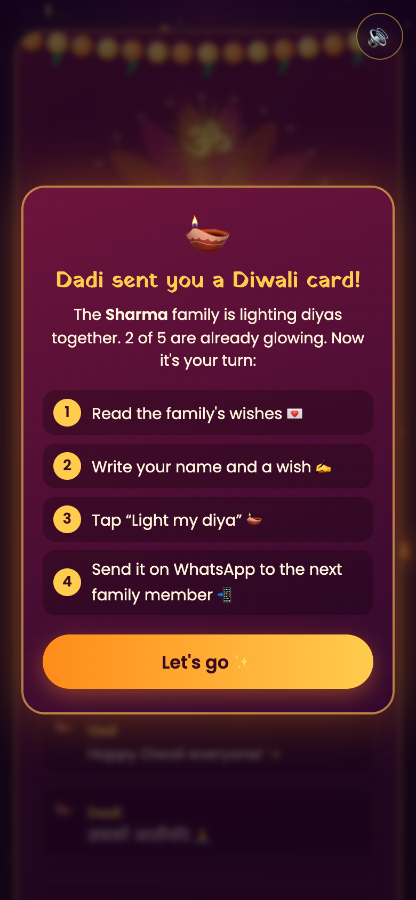
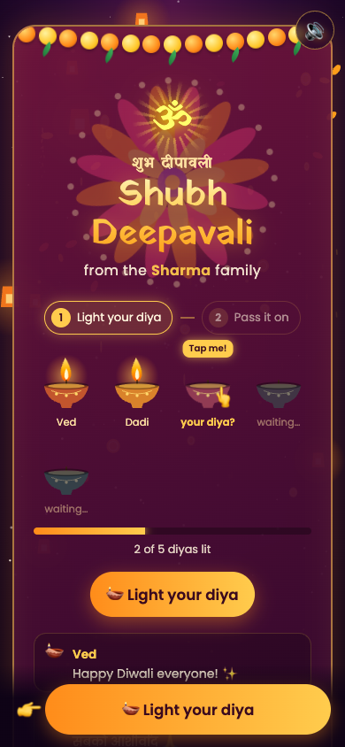
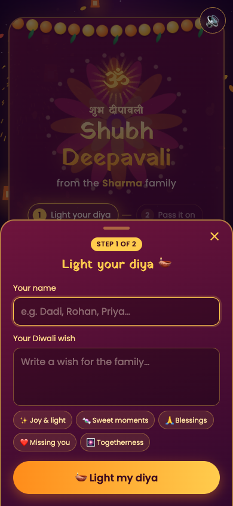
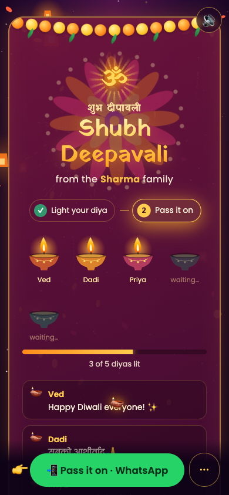
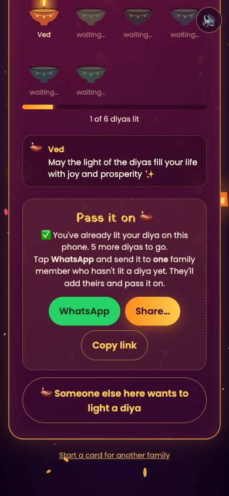

# Diwali Family Card: Product Brief

**A shareable, animated Diwali greeting that a family completes together, one person at a time.**

| | |
|---|---|
| **Status** | Working prototype, live |
| **Live URL** | https://ved-inkpen.github.io/diwali-card/ |
| **Platform** | Mobile web (any modern phone browser), desktop works too |
| **Install / login** | None. Opens from a WhatsApp link |
| **Backend** | None. A single static HTML file plus one audio file |

---

## 1. The problem

At Diwali, families swap greetings in WhatsApp groups. They look alike: a forwarded image, a "Happy Diwali 🪔", and a row of thumbs-up replies. Nobody really takes part. People receive greetings but rarely create anything together.

Most family members are not tech-savvy (parents, grandparents, young kids), so anything that needs an app install, a sign-up or a complicated flow fails.

## 2. The idea

One card goes around the family like a lamp passed from hand to hand.

1. Someone starts a card for their family and picks how many diyas (members) it has.
2. They write a wish, light the first diya, and send it on WhatsApp to one relative.
3. That relative opens it, reads everyone's wishes, adds their own, lights the next diya, and passes it on.
4. When the last diya is lit, the card finishes with a celebration, and the completed card can be shared with everyone.

The card becomes a small family project instead of another forward. Each person adds to it and sees it grow.

## 3. Target users

| User | Needs | What we designed for |
|---|---|---|
| **Starter** (usually 20–40, comfortable with tech) | Something nicer than a forward, quick to set up | Setup in under a minute: family name, member count, own name and wish |
| **Recipients** (any age, often low tech-confidence) | To know exactly what to do, with no reading required | A visual "tap me" diya, a bottom action button that always shows the next step, and one-tap wishes |
| **Family abroad** | Works on any phone, any network | No app, a light page (~1.6 MB song + ~60 KB page), works on any modern browser |

## 4. User journey

### 4.1 Opening the card: the "reveal"
Temple doors marked **शुभ** and **लाभ** wait for a tap. When tapped, they swing open, a bell rings and the song starts. Behind the doors are a glowing **ॐ**, a lotus, the Ganesh and Lakshmi mantras, and Lakshmi's footprints walking in. Fireworks and a shower of petals and coins follow, and then the card appears.


### 4.2 Recipient onboarding
A welcome popup names the person who sent the card and explains the four steps in plain language.



### 4.3 Step 1: Light your diya
The UI shows what to do without needing to read:
- a **step tracker** (① Light your diya → ② Pass it on) with the current step glowing
- the empty diya shows a **"Tap me!" bubble and a bouncing 👆**
- a **sticky bottom button** with a pointing 👉 hand



Tapping opens a **bottom sheet** with just two fields (name and wish) and quick-wish chips for people who'd rather not type.



### 4.4 Step 2: Pass it on
The person watches **their own diya ignite**, with fireworks, a chime, and petals and coins falling. A small 🪔 then **flies from their diya into the WhatsApp button**, showing that the light is passed on. The bottom bar becomes **📲 Pass it on · WhatsApp**.



The WhatsApp message is pre-written so that the next person knows what to do even before opening the link:

> 🪔 Priya just lit a diya in the Sharma family Diwali card! 2 more diyas to go.
>
> 👉 Open the link, write your wish, light your diya, then send it to the next family member: *(link)*

### 4.5 Returning visitors and shared phones
A person who reopens a card they've already lit is told so, and sees a full-size button for **"Someone else here wants to light a diya"**. Many families share one phone, so this case matters.



### 4.6 Completion
The last diya triggers a grand finale: a large **शुभ दीपावली** on screen, anaar fountains, a spinning chakri, a rocket barrage and a heavy shower of petals and coins. The card then glows gold, and the bottom bar becomes **🎉 Share the finished card**.

## 5. Feature summary

| Area | Features |
|---|---|
| **Core flow** | Create card (2–16 members), add a wish, light a diya, pass it on, completion |
| **Guidance** | Welcome popup, step tracker, tap-me diya, sticky action bar, bottom sheet, flying-diya animation, pre-written WhatsApp message |
| **Festive visuals** | Temple-door intro, ॐ and lotus, Lakshmi footprints, toran, rotating rangoli, flickering diyas, 5 firework types, anaar, chakri, sky lanterns, falling petals and gold coins, tap-the-sky fireworks |
| **Audio** | Background song; temple bell, diya chime, firework booms and crackles. A synthesized bansuri raag plays if the song can't load. Mute button, remembered per device |
| **Sharing** | WhatsApp (primary), native share sheet (Share…), copy link |
| **Language** | English UI with Devanagari elements; wishes can be written in any language or script (Hindi tested) |
| **Accessibility** | Phones set to reduce motion get a calm version with no intro or fireworks; buttons are large tap targets |
| **Mobile** | Tested at 320 / 360 / 390 px widths; no zoom-on-focus on iPhone; support for notched phones; spark limits for low-end devices |

## 6. How it works (technical overview)

**No server, no database.** The whole card state (family name, member count, names and wishes) is stored in the share link itself:

```
https://…/diwali-card/#eyJpIjoiYWJjMTIzNDUiLCJmIjoiU2hhcm1hIiwibiI6Niwi…
                       └─ base64url-encoded JSON (after the "#")
```

- Each time someone lights a diya, the app produces a **new link** that includes their wish, and that's the link they share.
- The part after `#` is **never sent to any server**, so wishes stay between the family's phones and WhatsApp.
- "Already lit on this phone" is remembered in the browser's local storage.
- Everything (animation, fireworks, synthesized music) runs in the browser using Canvas, CSS and the Web Audio API.
- Hosting is a static GitHub Pages site: free, with HTTPS (required for the native share sheet).

| Item | Value |
|---|---|
| Page size | ~60 KB HTML (all code inline) |
| Song | ~1.6 MB AAC (96 kbps), 2:10, loops |
| External requests | Google Fonts only (falls back to system fonts) |
| Limits | 16 members max, 24-character names, 140-character wishes |

## 7. Known limitations

| Limitation | Impact | Possible fix |
|---|---|---|
| **The card can split into versions.** Each link is a snapshot. If two people add diyas from the same older link, the card becomes two separate versions. | Medium: the intended flow is one person at a time, but group forwards will cause this | Add a small backend (e.g. a Firebase or Supabase row per card) so everyone sees one live card |
| **No analytics** | We can't measure starts, completion rate or drop-off | Add privacy-friendly event tracking (see §9) |
| **Duplicate names are only warned about** | Someone could add two diyas | Fine for families; would need a backend to fully prevent |
| **iPhone not yet tested on a real device** | Audio autoplay and keyboard behaviour on iOS Safari are the main risks | Test on iOS 16, 17 and 18 before a wider launch |
| **Links get long** as wishes are added (up to ~3.7 KB with 16 full-length English wishes; more with Hindi) | WhatsApp handles this, but some SMS apps may truncate | A backend with short IDs would fix it |
| **English UI** | Older relatives may prefer Hindi | Add a Hindi or regional-language toggle |

## 8. ⚠️ Risks that need a decision

**Music copyright: needs a decision before any wider launch.**
The background track is *"Happy Diwali"* from the film *Home Delivery* (rights held by T-Series). It is currently hosted as `song.m4a` in a **public** GitHub repository. This is **not licensed**. T-Series actively issues takedowns, and a takedown would disable the repo and **break every card already shared, mid-festival.**

Options:
1. **License the track** (contact T-Series or a licensing aggregator).
2. **Use royalty-free festive music** (e.g. a Pixabay-licensed track) or our own commissioned track.
3. **Use only the built-in synthesized raag** (bansuri, tanpura and tabla), which is already implemented and has no licensing risk.
4. Official YouTube embeds were tried. T-Series blocks embedded playback for its Diwali songs, but some Goldmines and Zee Music uploads (e.g. *"Aayi Hai Diwali"*) do allow it. Embeds require a visible video player and depend on YouTube availability.

**Recommendation:** for any company-branded or public launch, use option 2 or 3. The current version is suitable for a personal or internal demo only.

**Religious imagery:** the card uses ॐ, the Ganesh and Lakshmi mantras, and Lakshmi's footprints. These are traditional and handled respectfully (no illustrated deity figures, which are easy to get wrong). For a broad audience we may want a "secular" theme option (lights, rangoli and fireworks only).

## 9. Success metrics (proposed, not yet tracked)

| Metric | Definition | Why |
|---|---|---|
| **Cards started** | Cards created | Top-of-funnel interest |
| **Pass-on rate** | % of recipients who light a diya *and* share onward | The core loop; shows whether guidance works |
| **Completion rate** | % of cards where all diyas are lit | The "magic moment" |
| **Time to complete** | First diya to last diya | How viral the chain is within a family |
| **Drop-off step** | Opened → guide → sheet → lit → shared | Where people get stuck |
| **Re-shares of completed cards** | Shares after completion | Organic reach outside the chain |

## 10. Possible roadmap

**Next (small)**
- Named diyas: the starter enters family members' names up front, so the card can say "Waiting for Rohan…" and "Send it to Rohan next".
- Hindi UI toggle.
- Replace the copyrighted track (see §8).
- Real-device testing on iPhone and low-end Android.

**Later (medium)**
- A lightweight backend for a single live card per family (no splitting), short links and analytics.
- "Download as video or image" of the completed card for Instagram and WhatsApp Status.
- Voice wishes (record a 10-second blessing; useful for grandparents who don't type).

**Bigger bets**
- A reusable "pass-the-card" template for other festivals: Holi (colours), Eid (crescent and lanterns), Christmas (tree ornaments), Raksha Bandhan, birthdays and weddings.
- Branded or corporate editions (team Diwali cards).

## 11. Demo script (3 minutes)

1. Open the live URL on a phone and tap the doors (intro, bell, music).
2. Create a card: "Sharma", 4 members, your name, tap a quick wish, **Light the first diya**.
3. Show the flying diya and **Pass it on · WhatsApp**; send it to a colleague in the room.
4. On the colleague's phone: welcome popup, tap-me diya, sheet, light, pass on.
5. Repeat until the last diya is lit and show the **grand finale**.

> Tip for the demo: the browser remembers who has lit a diya, so use a different phone or an incognito window for each "family member".
